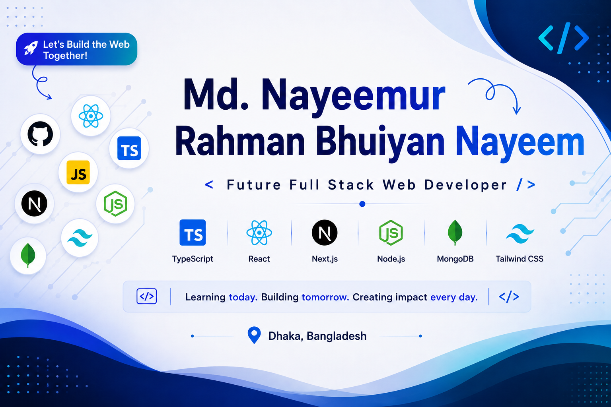

<h1 align="center">Hi 👋, I'm Nayeemur Rahman Bhuiyan Nayeem</h1>

<h3 align="center">Frontend Developer | Aspiring Full-Stack Developer</h3>

  Passionate about building modern, responsive, and user-friendly web applications.

---

## 💫 About Me

* 🔭 Currently working with **React, JavaScript, TypeScript & Tailwind CSS**.
* 🌱 Currently learning **Next.js & Node.js**.
* 💻 Building modern and responsive web applications.
* 🚀 Strengthening my Full-Stack Development skills through real-world projects.
* 🤝 Open to collaboration, open-source projects, and learning opportunities.
* 💡 Passionate about turning creative ideas into functional web applications.
* 📚 Always learning, exploring, and improving my development skills.

---

## 🌐 Connect With Me

  
  
  

---

## 💻 Tech Stack

### Programming Languages

  

### Frontend Development

  

### Backend Development

  

### Tools & Design

  

---

## 📊 GitHub Statistics

  
  

  

---

## 🐍 Contribution Activity

  

---

## 👀 Profile Visitors

  

---

  <b>Thanks for visiting my profile! 👋</b>
   
  <i>Keep Learning • Keep Building • Keep Growing 🚀</i>

